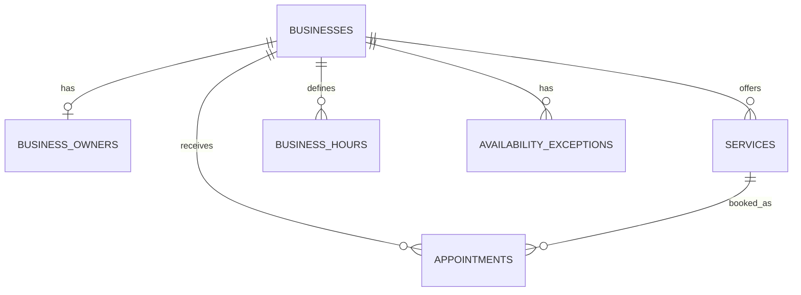

# Luz — Database Design

Status: Draft

## Overview

Luz uses a relational database (PostgreSQL) to manage
multiple businesses, their services, appointments,
working hours, and availability exceptions.

Each business has its own data, identified by business_id.

## 1. Businesses

Table: businesses

| Column | Description |
|--------|-------------|
| id (PK) | Unique business identifier |
| name | Business name |
| slug | Unique identifier used in public booking URLs |
| timezone | Business timezone (Asia/Jerusalem for MVP) |

Relationships:
- One business has many services.
- One business has many appointments.
- One business has many working-hour records.
- One business has many availability exceptions.

## 2. Services

Table: services

| Column | Description |
|--------|-------------|
| id (PK) | Unique service identifier |
| business_id (FK) | Business offering the service |
| name | Service name |
| duration_minutes | Service duration in minutes |
| price | Current service price in ILS |
| is_active | Whether the service is available for new bookings |

Relationships:
- Each service belongs to one business.
- One business can offer many services.
- One service can have many appointments.

Business Rules:
- Duration must be between 15 and 180 minutes.
- Duration must be a multiple of 15.
- Price must be non-negative.
- Only active services can be booked.
- Deactivating a service does not cancel existing appointments.
- Changes to duration or price do not affect existing appointments.

## 3. Appointments

Table: appointments

| Column | Description |
|--------|-------------|
| id (PK) | Unique appointment identifier |
| business_id (FK) | Business receiving the appointment |
| service_id (FK) | Service selected by the customer |
| customer_name | Customer's full name |
| customer_email | Customer's email address |
| start_time | Appointment start date and time |
| end_time | Appointment end date and time |
| price_at_booking | Service price at booking time |
| status | CONFIRMED or CANCELLED |
| created_at | Timestamp when the booking was created |

Relationships:
- Each appointment belongs to one business.
- Each appointment references one service.
- One service can have many appointments.

Business Rules:
- start_time must be earlier than end_time.
- The service must belong to the selected business.
- Confirmed appointments cannot overlap within
  the same business.
- Cancelled appointments remain in the database
  but do not block availability.
- The appointment must fit within available
  working hours.
- The service price and appointment duration
  are preserved after booking.
- Bookings are accepted only 60 minutes to
  30 days in advance.

## 4. Business Hours

Table: business_hours

| Column | Description |
|--------|-------------|
| id (PK) | Unique record identifier |
| business_id (FK) | Business owning these working hours |
| day_of_week | Day of the week |
| open_time | Opening time |
| close_time | Closing time |

Relationships:
- Each record belongs to one business.
- One business can have multiple working-hour records.

Business Rules:
- open_time must be earlier than close_time.
- Days without working-hour records are considered closed.
- Appointments must fit entirely within working hours.
- Changes that conflict with future confirmed
  appointments are rejected.

## 5. Availability Exceptions

Table: availability_exceptions

| Column | Description |
|--------|-------------|
| id (PK) | Unique exception identifier |
| business_id (FK) | Business owning this exception |
| date | Specific calendar date |
| type | CLOSED, BLOCKED, or OVERRIDE |
| start_time | Start time, when applicable |
| end_time | End time, when applicable |

Exception Types:
- CLOSED: The entire date is unavailable.
- BLOCKED: A specific time range is unavailable.
- OVERRIDE: Working hours for this date are replaced
  by the specified time range.

Business Rules:
- Exceptions affect only their specified date.
- CLOSED exceptions do not require start/end times.
- BLOCKED exceptions remove availability.
- OVERRIDE exceptions replace recurring working hours.
- Changes conflicting with future confirmed
  appointments are rejected.
- Existing appointments are never cancelled
  automatically.

## 6. Business Owners

Table: business_owners

| Column | Description |
|--------|-------------|
| id (PK) | Unique owner identifier |
| business_id (FK, UNIQUE) | Business managed by the owner |
| email (UNIQUE) | Owner's login email |
| password_hash | Securely hashed password |
| name | Owner's full name |

Relationships:
- Each owner belongs to one business.
- Each business has one owner in the MVP.

Business Rules:
- Email addresses must be unique.
- Passwords must never be stored in plain text.
- Owners can manage only their own business.
- Self-registration is outside the MVP scope.

## 7. Entity Relationship Diagram

## 8. Availability Calculation Rules

Available time slots are calculated in this order:

1. Start with the business's recurring weekly hours.
2. If an OVERRIDE exists for the date, replace the weekly hours.
3. If the date is CLOSED, no slots are available.
4. Subtract all BLOCKED time ranges.
5. Subtract all CONFIRMED appointments.
6. Generate valid starting times at 15-minute intervals.

Constraints:
- At most one OVERRIDE or CLOSED record per date.
- CLOSED and OVERRIDE cannot coexist on the same date.
- Multiple BLOCKED ranges are allowed.
- Every appointment must fit entirely within an available interval.
- Availability changes must not conflict with future confirmed appointments.
- Existing appointments are never cancelled automatically.
- Final availability is also subject to the booking window:
  at least 60 minutes ahead and no more than 30 days ahead.

These rules must be enforced by the backend.
Database constraints will provide additional protection
where applicable.

